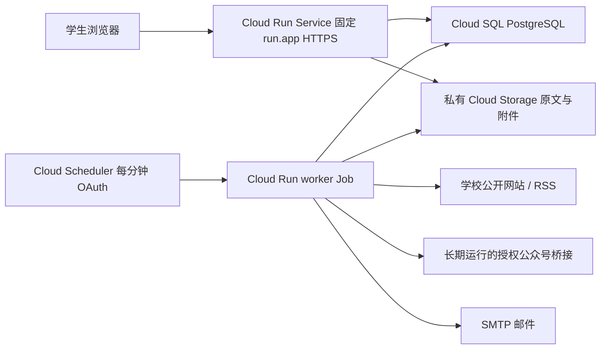

# Google Cloud 固定网址部署

这是可部署材料，**当前没有 Google Cloud 项目，也没有创建资源、执行云构建或上线**。`deploy.ps1` 默认只打印参数化计划；只有传入 `-Apply` 才会调用 gcloud。学校网络、真实公众号授权、Cloud SQL、私有桶和 SMTP 必须在部署环境验收。

## 运行架构



同一镜像提供 `python -m server.campus.cloud_run serve`、`worker`、`init-sources` 三个入口。Service 监听 `0.0.0.0:$PORT`（默认 8080），禁止内嵌 worker。固定 URL 来自服务的 `status.url`，后续更新同一个 service 的 revision，学生入口沿用这个网址。不要使用临时预览地址或 revision tag 地址；保留项目、地区和服务名，不承诺删除重建仍能保留原地址。[Google 服务 URL](https://docs.cloud.google.com/run/docs/triggering/https-request)

worker Job 默认最多启动 100 个作业、执行 500 轮、在 240 秒预算耗尽后停止领取任务；预算和 SIGTERM 在每个作业边界检查，已经领取的作业正常结束，因此总时长可能超过 240 秒。Cloud Run 任务超时设为 1800 秒，永久循环 worker 不用于周期 Job。系统仍使用持久化租约、幂等键、事务 outbox 和失败退避；进程被强杀的作业等待租约到期恢复，最长约 1 小时。Scheduler 每分钟推进队列、提醒和摘要，来源刷新默认设为 1800 秒（普通本机仍是原来的 6 小时）。这表示检查间隔目标，不能承诺所有来源 30 分钟内发布完成，来源错误、审核和队列延迟会影响结果。

快照采用官方 `google-cloud-storage` SDK 和 Cloud Run 附加服务账号的 ADC，不需要下载服务账号 JSON 私钥。对象保持原来的 `snapshots/<snapshot_id>/<sha256>.bin` 键；上传以 `if_generation_match=0` 只创建，已有对象核验 SHA-256；读取按 generation 固定版本、最多 8 MiB 并再次核验哈希。学生下载仍经过原来的公开状态/撤回检查与短期 read_token；审核下载仍核验管理员身份和 token 归属，应用返回附件字节，不公开桶，也不重定向到桶 URL。本机默认 LocalBlobStore，普通依赖无需安装 Google SDK。

Cloud Run 实例的本地文件系统不持久且计入内存，本地 `/tmp/campus` 只用于临时目录；数据库与原文不能留在实例磁盘。Google 默认请求计费时后台 CPU 和实例存活不能作为调度保证，因此使用 Job，不靠浏览器访问维持 worker。[容器要求与生命周期](https://docs.cloud.google.com/run/docs/container-contract)、[CPU/计费模式](https://docs.cloud.google.com/run/docs/configuring/billing-settings)

## 第一次准备账户与资源

1. 创建自己的 Google Cloud 账户、项目，绑定有效结算账户。确认预算与地区费用，设置实例上限和费用通知。免费额度不等于整个系统免费：Cloud SQL、网络出口、存储请求、镜像构建、Scheduler、Secret Manager、邮件均可能收费。[Cloud Run 价格](https://cloud.google.com/run/pricing)、[Cloud SQL 价格](https://cloud.google.com/sql/pricing)、[Scheduler 价格](https://cloud.google.com/scheduler/pricing)
2. 在项目启用 Cloud Run、Cloud Build、Artifact Registry、Cloud SQL Admin、Cloud Storage、Secret Manager、Cloud Scheduler API。创建同地区 Artifact Registry Docker 仓库、Cloud SQL PostgreSQL 实例及数据库用户/库、私有 Cloud Storage 桶、两个不同的运行与调度 service account。部署脚本不会替你创建这些基础资源，也不会改 IAM 以获得宽泛权限。
3. 桶必须启用 **uniform bucket-level access** 与 **public access prevention=enforced**，不能有 `allUsers` / `allAuthenticatedUsers` 读取授权；脚本 Apply 前会用 `buckets describe --raw` 检查这两个属性。设置备份、保留和删除策略前先按学校数据需求评估，不能自动删除仍被证据引用的快照。[公开访问防护](https://docs.cloud.google.com/storage/docs/public-access-prevention)
4. 创建 Secret Manager secrets：数据库连接 URL、至少 32 字符的应用随机密钥、SMTP 密码。部署参数只传 `secret-name:具体版本号`，不接受 `latest`，不在脚本填写 secret 明文。应用密钥应与数据库共同保留，轮换会使旧签名/日历 token 失效。[Secret Manager 接入](https://docs.cloud.google.com/run/docs/configuring/services/secrets)
5. 配置真实 SMTP 供应商，本脚本用 587 STARTTLS。邮件必须能投递到实际学生邮箱；验证码收到前不视为登录成功。需要 465 SSL 的供应商应审阅调整脚本 env 中 port/SSL/STARTTLS，而非关掉 TLS。

数据库 secret 示例格式（只表示格式，不能把此占位值直接保存为生产凭据）：

```text
postgresql+psycopg://USER:URL_ENCODED_PASSWORD@/DATABASE?host=/cloudsql/PROJECT:REGION:INSTANCE
```

Cloud Run 附加这个 Cloud SQL 实例，连接通过 `/cloudsql/...` Unix socket，使用 Google 管理的连接加密。按 Google 文档设置适合第二代 Cloud Run 的 Cloud SQL CA，API、Job 和数据库放同地区。本部署初期 API 最大 3 个实例、并发 16；当前 SQLAlchemy 默认池每进程最多 5 条常驻加 10 条临时连接，因此 API 理论峰值 45 条。获锁 worker 另用一条独立连接持有执行锁，队列事务使用其他连接；重叠但被跳过的 Job 也短暂需要数据库连接。按数据库规格预留运维、初始化与短时重叠余量，监控连接数再调整实例上限。每个 Cloud Run 实例最多 100 条 Cloud SQL 连接不是整个项目的总预算。[Cloud SQL 官方连接指南](https://docs.cloud.google.com/sql/docs/postgres/connect-run)

## IAM 范围

由资源管理员按下表配置最小范围，脚本不授予项目 Owner。首次私有部署创建 worker Job 后，再授予 scheduler account 该 Job 的 Invoker 权限，随后启用 Scheduler；其他资源权限应提前就绪：

| 身份 | 权限与范围 |
|---|---|
| runtime account | 本项目 `roles/cloudsql.client`；指定桶 `roles/storage.objectCreator` + `roles/storage.objectViewer`；只对所需 secret 授予 `roles/secretmanager.secretAccessor` |
| scheduler account | 仅 worker Job 的 `roles/run.invoker`；不授予学生公开 API 管理权限 |
| 部署人员 | Cloud Run 部署、Cloud Build 提交、Cloud Scheduler 管理，以及对上述 service accounts 的 actAs；读取指定桶属性和 secret 元数据；开放学生入口时需要修改该 service IAM 的权限 |
| Cloud Build 执行账号 | 指定 Artifact Registry 仓库写入、构建源读取与日志写入，按组织的构建账号配置 |
| Cloud Scheduler 服务代理 | 保留 Google 创建的 Cloud Scheduler Service Agent 角色，用于签发调度凭据 |

调度访问目标是 `https://run.googleapis.com/v2/projects/.../locations/.../jobs/...:run`，这是 Google API，所以使用 **OAuth**。如果改成调用私有 Cloud Run HTTP Service 才使用 OIDC + audience=服务根 URL；本实现没有额外的公网“执行全部任务”接口。[Scheduler 认证区别](https://docs.cloud.google.com/scheduler/docs/http-target-auth)、[Job 定时执行](https://docs.cloud.google.com/run/docs/execute/jobs-on-schedule)

## 审阅与两阶段部署

进入应用根目录，复制 `parameters.example.ps1` 到同目录的自用参数文件，填写上面的**已有**资源。示例中的项目、邮箱和地址都是占位符，没有实际资源。不要将真实凭据写进参数文件；secret 参数只包含名称和数字版本。

```powershell
# 默认 review-only：无云命令、无资源变更、无费用。
& ./deploy/cloudrun/parameters.example.ps1
```

如当前 PowerShell 禁止运行脚本，可在独立进程使用 `powershell -NoProfile -ExecutionPolicy Bypass -File ...` 运行自己的已审阅文件；这不会持久修改系统执行策略。推荐先查看脚本源码。

确认参数后，在自用文件使用：

```powershell
& "$PSScriptRoot/deploy.ps1" @CampusDeploy -Apply
```

脚本会构建镜像、创建/更新 **私有** Service，先给不可用的 `https://bootstrap.invalid` origin；取得实际 `status.url` 后回填 `CAMPUS_PUBLIC_ORIGIN` 和精确一致的 `CAMPUS_ALLOWED_ORIGINS`，再创建/更新 worker 与 init Jobs。没有 wildcard CORS，不为冷启动放开写接口。`CAMPUS_PUBLIC_ORIGIN` 只允许不含账号、路径、query、fragment 的 HTTPS origin；快照链接不依赖客户端 Host 或伪造的代理头。Uvicorn 关闭访问日志与任意转发头信任。

构建上传使用专用 `.gcloudignore` 排除 `.env`、运行数据、`.server-secret`、数据库、快照、依赖目录；Docker 构建另外使用 `Dockerfile.dockerignore`。执行前检查自己额外创建的秘密文件也被排除。Cloud Build/Docker 未在当前交付环境实际运行；镜像构建成功后才进入云端验收。

更新已有环境时，脚本先检查私有桶，再暂停已存在的 Scheduler；输入的 feed secret 引用在任何云操作之前校验。后续步骤失败时调度保持暂停，只有显式 `-EnableScheduler` 才更新并恢复。暂停不会终止已经运行的旧版本 Job；升级到本次执行锁版本前，先等待旧执行结束或在维护窗口停止旧执行，再更新。新版 worker 用 PostgreSQL 会话 advisory lock 防止多个定时执行同时 drain：获锁连接独立于队列事务并持有至结束，未获锁执行输出 `skipped=1`、全部处理计数为 0，且不扫来源、不派发 outbox、不领取任务。进程退出/数据库连接关闭会释放锁，单任务租约仍负责中断后的恢复。`--tasks=1 --parallelism=1` 只控制一次执行内部，不能替代跨执行锁。

本地只读预检可在没有 Google Cloud 项目时执行：

```powershell
python deploy/cloudrun/preflight.py
& ./deploy/cloudrun/test_deploy.ps1
```

第一条只检查文件、镜像 digest、锁文件与秘密排除配置；第二条用本地 gcloud 函数替身验证参数流，不连接云端。准备好真实环境后可显式执行 `python deploy/cloudrun/preflight.py --database-read-only --service-url https://实际服务.run.app`。数据库 URL 从 `CAMPUS_DATABASE_URL` 读取，只进行只读事务与 SELECT/SHOW，不初始化表或领取任务；私有服务验收 token 可放在 `CAMPUS_CHECK_IDENTITY_TOKEN`，仅发送给指定 HTTPS run.app origin，拒绝重定向。结果输出表/队列计数与健康判定，不输出数据库 URL、口令、学生正文或 token。

先手动运行一次 init Job，只注册官方来源，不生成合成通知；再运行 worker Job，检查真实采集结果：

```powershell
gcloud run jobs execute tju-campus-init --region=asia-east2 --project=YOUR_PROJECT --wait
gcloud run jobs execute tju-campus-worker --region=asia-east2 --project=YOUR_PROJECT --wait
```

用具有 Cloud Run Invoker 权限的身份经 HTTPS 访问私有接口，核验健康、验证码实际收信、两名学生隔离、候选审核、原文附件、证据搜索、撤回、摘要和提醒。不要为了私有浏览器代理测试添加 localhost 到生产 CORS；私有验收可用带 IAM identity token 的 HTTPS API 请求。开启公开学生入口后再补实际浏览器验收。

### 日志与打开入口

Cloud Run **平台自动生成请求日志**，即使 Uvicorn access log 关闭。日历 token 和快照 read_token 位于 URL，不能把完整 URL 导出到分析服务或普通可共享日志。开放前，在 Cloud Logging 每个收集本服务 request logs 的 sink 中添加排除规则或经过审批的脱敏路由；保留不含 URL/正文的计数与错误监控。建议排除条件（替换实际项目和服务）：

```text
resource.type="cloud_run_revision"
resource.labels.service_name="tju-campus"
logName="projects/YOUR_PROJECT/logs/run.googleapis.com%2Frequests"
```

检查 `_Default`、组织/项目自定义 sinks 及第三方日志收集，不能只检查一个 sink。排除规则影响未来写入，已产生的验收 token 可撤销/等待到期；日历 token 验收后主动撤销。Cloud Audit Logs 的运维审计应保留，不在此排除范围。[Cloud Run 自动日志](https://docs.cloud.google.com/run/docs/logging)、[Cloud Logging 路由](https://docs.cloud.google.com/logging/docs/routing/overview)

验收与日志配置完成后，显式选择调度和学生公开访问：

```powershell
& "$PSScriptRoot/deploy.ps1" @CampusDeploy -Apply -EnableScheduler -OpenToStudents
```

`OpenToStudents` 仅给这个 Service 的 `allUsers` 授予调用权限，应用自身学生登录、CSRF、管理员角色、个人资料隔离继续生效；不公开 worker Job/数据库/桶。脚本重复执行会经历私有 bootstrap 阶段，安排维护窗口；固定网址保持同一 Service。Cloud Scheduler 失败/队列积压、邮件失败与来源失效应进入运营监控。

## 网站与微信公众号运营

学生选择来源不代表每个人各跑一次采集；共享来源后台采集，学生订阅决定看哪些事项。公开学校网站使用有界采集和 SSRF 防护，不扫描校园内网或绕过登录。新增网站需要审核适配、核验原文来源身份与健康状态。

微信公众号需要可用的官方授权接口或长期维护的 WeRSS/RSSHub 等授权桥接，桥接 RSS 读取端也必须由私网或鉴权代理保护，不能假定管理端 JWT 会保护 RSS 路由；管理鉴权与本应用读取 feed 的 bearer token 是不同凭据。桥接本身是独立持久化服务，账号凭据/授权刷新不能放在每次自动销毁的 worker Job 中重新登录。学校公开文章可按实际上游支持采集，不能承诺任意公众号全量历史或永久无授权抓取；已授权桥接未配置时明确显示待接入/失败，不伪造成功。相关接入见 `../campus/ADAPTERS.md`，后续配置应保留上游请求限速及授权状态监控。

本脚本可直接接入可达的公网 HTTPS 鉴权网关；私网桥接还需另行配置 VPC 网络与精确的信任 origin，不能仅靠填内网域名。创建来源后，将实际 UUID 对应的解析配置写入 `config/campus-sources.json`，构建新版本镜像。受保护 feed 的 Bearer token 保存为单独 Secret Manager secret，并在自用参数的 `FeedSecrets` 中加入 `CAMPUS_SOURCE_<去横线大写UUID>_TOKEN = 'secret-name:具体版本'`。运行账号只需该 secret 的 accessor 权限；脚本把引用同时配置到 Service 和 Jobs，凭据不进入网页或镜像。每次部署保留完整 FeedSecrets；脚本使用 set-secrets，遗漏的旧 feed 引用会被移除。上游微信管理凭据留在独立桥接，不填这里。

## 从本地存储迁移与恢复

新云项目没有历史资料时，不必迁移演示数据库或合成原文。已有真实实例切换 GCS 时，先停写并备份 PostgreSQL、应用 secret 和来源配置；把数据目录下 `snapshots/` 按原相对路径复制到私有桶，例如先用 `gcloud storage rsync ./snapshots gs://YOUR_BUCKET/snapshots --recursive --no-clobber --dry-run` 审阅，再去掉 dry-run 执行。no-clobber 跳过已有对象，不使用删除目标的选项；已有同名对象仍须下一步核对哈希。[官方 rsync 参数](https://docs.cloud.google.com/sdk/gcloud/reference/storage/rsync) 由迁移身份完成复制，运行账号保留只创建/读取权限。

逐一按数据库 snapshots 记录的 object_key 和 content_hash 核对本地与云对象 SHA-256，数量和大小也应一致；只有抽样打开原文不足以证明完整。核对完成后再切换 `CAMPUS_BLOB_STORE=gcs`，在隔离验收实例验证公开、撤回和管理员附件权限。恢复或回滚须保持数据库、原文对象与应用密钥配套；未完成核对就保持原存储配置。SDK 运行适配不会自动搬运历史文件，也不会删除孤立对象。

## 地区、费用与验收边界

部署前可运行 `python deploy/cloudrun/probe_sources.py` 预览官方目录；显式加 `--network` 后才用产品安全采集器对列表、少量正文和附件做只读网络验收，不写数据库或来源健康。固定 `run.app` 地址与采集出口、学生网络可达性分别验收；DNS fake-IP 诊断、脱敏报告、同镜像独立 Job 的未来执行方法见 [真实网络验收](NETWORK_ACCEPTANCE.md)。当前本机 15 个栏目均在 DNS 公共地址检查阶段被拦截，不能算学校实采通过。

可先选择香港 `asia-east2` 并把 SQL/桶放同地区；Google 的地区存在不代表天津大学校园网、各运营商或微信内置浏览器一定能直连 `run.app`。必须用校园 Wi-Fi、手机流量和微信内置浏览器实测登录、静态资源、附件和日历；没有这些实测时不承诺国内可达性。[Cloud Run 地区](https://docs.cloud.google.com/run/docs/locations)

当前已验证本地 SQLite、隔离的真实 PostgreSQL 17.11 并发/CAS/幂等/事务/outbox/租约/跨执行锁、多 runtime 快照一致性、GCS SDK 调用协议 mock、权限签名门禁、有界多轮 outbox、部署脚本 dry-run 和八种本地替身部署情形；具体证据见 [运营验收记录](OPERATIONS_ACCEPTANCE.md)。没有真实 GCS/Cloud SQL/SMTP/公众号/Google Cloud 容器验收，本地 PostgreSQL 不等于 Google 托管环境已经通过。正式上线前完成备份恢复演练，数据库、桶对象和应用密钥一起备份；恢复用隔离环境，不覆盖使用中的学生数据。 SDK 于 2026-10-08 从 PyPI 实查 `google-cloud-storage==3.16.0`，新增依赖见 `requirements-cloud.lock.txt`，普通依赖锁未修改。
