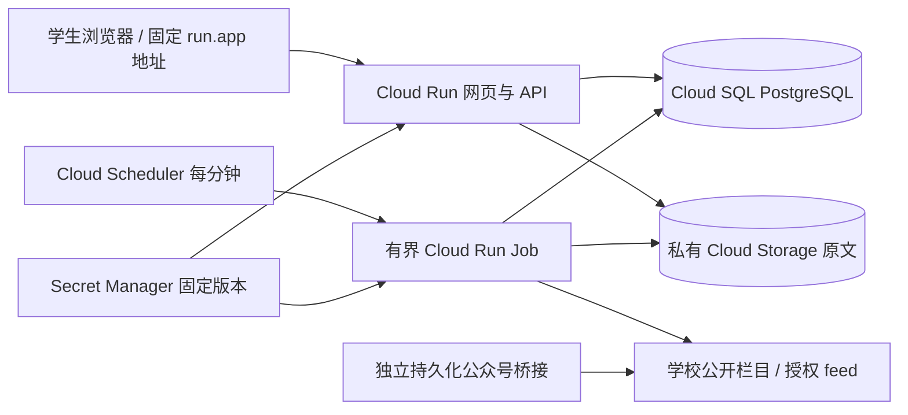

# 偷闲·天大版 1.1：云部署与自主订阅

本版把“信息源由运营接通”和“学生自己选择关注什么”连接成完整流程，并准备 Google Cloud 固定网址部署。当前没有云项目，交付的是可运行源码、预构建网页和可审核的部署材料；尚未发布公网服务。

## 学生怎样使用

在“信息来源”按名称、网址、网站或公众号类别寻找已启用来源，选择关注全部或仅所选来源。“仅所选”可以保存零个来源；已经收藏的事项保留，个人事项不受这个选择影响。事项类别仍独立生效。

没有找到所需来源时，填写公开网站栏目地址，或公众号名称/微信公开文章链接。可勾选接通后自动关注，并在自己的申请列表查看待处理、已接通或未接入的原因。申请不会公开给其他学生，也不会直接让服务器访问未知网址。

运营在“接入申请”处理申请：先在来源管理创建/匹配来源、核对学校或单位身份，配置网站规则或获授权的公众号 feed，然后实际采集。只有已启用、身份核验通过、健康且有成功记录的同类来源才能连接申请。勾选自动关注只影响申请者自己的设置。

## 自动更新与微信边界

一次采集结果供全部订阅学生使用，不按学生人数重复抓取。云部署默认每分钟执行一次有界队列任务，启用来源约每 30 分钟安排检查；待处理任务、解析和人工核对仍会影响信息可见时间，不能承诺实时或无遗漏。

微信公众号通过独立、持久化且获授权的 WeRSS/RSSHub 或其他 feed 桥接接入。扫码、会话续期、正文可读性由桥接维护；仅有公众号名称或可读 feed 不能证明全文已接通。详细步骤见 [信息源与微信桥接](deploy/campus/ADAPTERS.md)。学生无需在本应用提交微信密码、Cookie 或密钥。无法自动读取的内容仍可用本地文字/截图整理为私人待办。

## 云端组件

保持同一项目、区域和 Cloud Run 服务，更新版本沿用服务网址；脚本从服务实际 `status.url` 读取地址并写入公开 origin 与跨域配置，不编造网址。数据库和原文不依赖容器临时磁盘。完整步骤、先决资源、权限、备份和回滚见 [Cloud Run 部署指南](deploy/cloudrun/DEPLOY.md)。脚本默认预览，显式执行才会修改云资源。

需要自行创建 Google Cloud 项目并启用结算，准备 PostgreSQL、私有存储桶、SMTP 和服务端密钥。Cloud Run、数据库、存储与定时器可能产生费用，当前未创建资源。天大校园网、移动网络和微信内浏览器对真实网址的可达性要在上线时实测。

## 兼容与回滚

来源申请使用新逻辑集合，不修改已有记录结构。`Subscriptions.source_mode` 为可选：旧客户端空来源数组仍表示全部，非空仍表示只关注这些来源；新客户端显式保存 `all` 或 `selected`。先部署后端再更新网页，避免旧后端拒绝新字段。回滚到 1.0.1 前备份数据并将订阅中的 `source_mode` 转回旧格式；“零个所选来源”在旧版中无法表达，应保留备份或告知受影响用户后调整，不能静默改成全订阅。

本地快照不自动搬迁到 GCS。切换存储前备份数据库和原文，按部署指南迁移相同 object_key 并核对内容哈希；迁移完成前维持原存储读写配置。数据库、固定服务端 secret、来源配置和 GCS 备份应成套保存。

## 多 AI 分工与整合

| 负责人 | 独占修改范围 | 交付检查 |
|---|---|---|
| 总集成 | DTO/OpenAPI、来源申请、订阅语义、调度间隔、文档与发布包 | 权限、幂等、兼容、56 接口契约和最终串行集成 |
| 来源界面代理 | `src/campus/App.jsx`、`api.js`、`campus.css` 与界面测试 | 学生选择、申请进度、运营处理、桌面和手机流程 |
| 云部署代理 | `deploy/cloudrun/`、`cloud_run.py`、`blob_store.py` 与快照 IO 适配 | PORT/HTTPS、有界 Job、私有 GCS、依赖锁、脚本预览 |
| 独立复核代理 | 只读检查集成差异 | 跨用户访问、自动关注边界、云部署与持久化风险 |

各代理使用独立分支和工作目录，先冻结接口，再各自提交；总集成顺序合并后统一测试和打包。后续交接以 [CAMPUS_HANDOFF.md](CAMPUS_HANDOFF.md) 和本版契约为准。此前架构包是目标蓝图，运行能力以 [IMPLEMENTED.md](IMPLEMENTED.md) 与 [ACCEPTANCE.md](ACCEPTANCE.md) 的实际记录为准。
