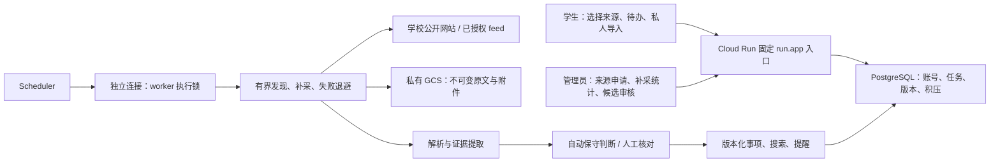

# 偷闲·天大版 1.2.0 补采与提取增强

这版优先减少漏通知和误读办理要求。它是可运行、可部署的交付版本；尚未发布公网服务，也没有真实公众号授权或学生试用效果数据。Google Cloud 项目仍由你以后准备，当前没有创建收费资源。

## 学生与管理员能得到什么

- 官方目录从 3 个栏目扩为 15 个栏目、8 个官方主机，包括研究生培养/学位/奖助、就业、国际交流和部分学院；保留原来的订阅 ID。学生可继续选择全部、部分或零个来源。
- 不再每次只处理列表最前 8 条。每次发现最多 100 条，按每批 8 篇持久化补采，任务重启后继续；成功文章轮换复查，失败文章退避重试，不阻塞后面的通知。
- 临时列表故障时，已发现的安全 URL 仍可补采；授权过期和安全校验失败会停止，不被当成临时故障绕过。
- 管理员能看到当前记录窗口的已完成、待补采、失败数量及截断提示。学生接口不暴露后台统计。
- 报名区间、活动日期、括号星期、材料豁免和明确申请表的提取更准确。无法判断的年份、工作日和条件仍要求复核。
- 附件抓取恢复后清除旧错误，当前未成功读取的附件不会伪装为已完成；超出 4 个附件会明确提示。旧 `.doc/.xls` 二进制提示人工处理。
- 原文 A→B→A 时切回正确快照并生成新的待审核候选。审核后的事件冻结观察先后，迟到的旧任务不能覆盖新状态；原文及历史证据保持不变。
- Google Scheduler 重复启动的 worker 使用 PostgreSQL 独立会话锁，重叠执行明确跳过；进程退出后锁自动释放，单项任务仍靠持久租约恢复。

## 运行架构与 AI 分工

沿用 56 个 API 与原有 8 类任务，不另起一套服务。只给 `AdminSource` 增加可选的 `ingestion` 字段；完整契约位于 `campus-contracts`。本机默认 SQLite/本地快照，云端用 PostgreSQL/私有 GCS。

| 独立责任 | 本轮文件边界 | 合并验收 |
| --- | --- | --- |
| 来源代理 | 目录、覆盖说明、短摘录语料及目录测试 | 身份证据、稳定 ID、官方域名边界 |
| 提取代理 | content、提取回归、逐项评估报告 | 连续原文证据、保守日期、历史候选 |
| 运营代理 | Cloud Run、预检、部署与 PostgreSQL 检查 | 真实并发、退出恢复、部署失败保护 |
| 集成代理 | sources、ingestion、events、契约、界面及发行包 | 补采全链路、回退发布、权限、浏览器和独立包 |

各代理在独立分支工作，集成代理串行合并并运行统一回归。后续协作继续以唯一文件负责人和共享契约为准，避免多个 AI 同时改同一核心文件。

## 本版验收

| 检查 | 实际结果与范围 |
| --- | --- |
| 全部后端 | 223 项通过、65 个子检查通过；普通运行明确跳过 8 项真实 PostgreSQL 检查 |
| 真实 PostgreSQL 17.11 | 8 项真实数据库检查通过；连同执行锁/预检单元共 18 项及 8 个子检查通过，使用独立临时 loopback 集群 |
| 前端 | 22 项通过，生产构建成功 |
| 真实本机浏览器 | 11 项原有流程（含中文 OCR）及 8 项来源/补采统计流程通过；使用明确标识的合成通知，没有模拟 HTTP 响应 |
| 接口契约 | 56 个 API 的成功路径及本轮可选字段通过集成核对 |
| 部署 | 8 类本地 gcloud 替身情形、PowerShell 语法和 6 项默认只读预检通过；未执行真实 Google 部署 |
| 20 条官方短摘录 | 开发语料的日期/材料字段集合匹配 12/20 → 20/20；详见 EXTRACTION_QUALITY.md，不能称为全站准确率 |

PostgreSQL 验收覆盖首次写入/更新 CAS、幂等入队、事务/outbox 回滚、并发领取与租约 fencing、跨 runtime 持久化、工作进程互斥、终止进程后恢复及只读预检。下载来源与未签名发行物的限制见 `deploy/cloudrun/OPERATIONS_ACCEPTANCE.md`。便携数据库二进制及临时数据不进入发行包。

`validation/extraction` 保存逐项提取结果；发行包的 `本版验收记录` 保存后端报告、浏览器截图和发行清单。测试样本与使用效果需要分开：尚未测量真实学生节省多少时间，也没有完整公告的随机留出测试。

## 覆盖与使用边界

**15 个栏目是已核验身份的来源目录，不是 15 个已成功运行的采集源。** 本机实际安全采集器探测全部返回 `unsafe_address`，当前网络把相关学校域名解析到非公网地址。结果保存在 `SOURCE_FETCH_PROBE.json`，来源初始状态仍是 `never_checked`。需在部署网络重新核验正文及附件，不关闭安全检查。

补采只覆盖已发现窗口：单列表最多 100 条，每来源最多保留 500 条状态，超限时提示；不承诺遍历整站历史分页或未授权内容。`completed_count` 表示该文章成功抓取，不代表所有附件完整、已审核或已发布。当前窗口有失败项会保留来源降级提示；文章和列表自动退避最多 5 次，之后由后续定时检查或人工抓取再尝试。

微信公众号需运营接通获授权的 feed。学生自由选择已接入来源；新增网站/公众号走申请和核验流程。名称、文章链接及私有截图导入不等于已获公众号抓取授权。教务部分栏目大量跳到微信，招聘简章登录页、本科资助专门来源和班级群仍有缺口，见 `SOURCE_COVERAGE.md`。

## 运行、升级与部署

Windows 安装 Python 3.12+ 后运行 `start-campus.ps1 -Demo`，打开本机 8000 端口。发行包包含已构建网页；首次安装 Python 依赖需要网络。演示数据有明确标记。

升级现有实例前备份数据库、快照和应用密钥。旧订阅、原文、候选、事件及私人事项保留；新增状态使用既有记录表，无破坏性 schema 迁移。已有候选遇到新规则重新提取会进入核对，避免悄悄改写已发布事项。

首次升级到跨执行锁版本前，先暂停旧调度并确认旧 worker 执行已结束。旧代码尚不认识新锁，不能只凭新锁宣称新旧 worker 一定互斥。新部署脚本更新已有调度时先暂停，构建失败保持暂停，显式启用后才恢复。

Google Cloud 按 `deploy/cloudrun/DEPLOY.md` 和 `parameters.example.ps1` 准备现有资源，默认命令只预览；后续更新同一 service 沿用它提供的 `run.app` 地址。上线前仍需实际镜像构建、Cloud SQL/GCS、SMTP、学校与微信内网络可达性、真实采集和备份恢复验收。

旧版 1.1 交付包独立保留。本版不会替你创建项目、开通结算、发送外部消息或部署公网服务。
