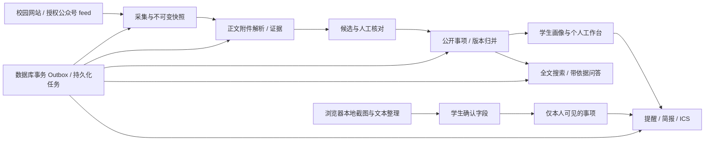

# 偷闲·天大版

产品版本 **1.8.0**（页面美化轮次 **1.4.0**）。设计参考、界面改进与验收见 [UI_POLISH_RELEASE.md](UI_POLISH_RELEASE.md)。服务端沿用 1.3 授权供稿与正文增强版，方法与分工见 [WEB_RESEARCH_RELEASE.md](WEB_RESEARCH_RELEASE.md)，公众号接入见 [WECHAT_FEED_GUIDE.md](WECHAT_FEED_GUIDE.md)。此前 1.2 记录见 [IMPROVEMENT_RELEASE.md](IMPROVEMENT_RELEASE.md)，云部署与自主订阅说明见 [CLOUD_SOURCE_RELEASE.md](CLOUD_SOURCE_RELEASE.md)。1.8.0 的改动见 [UPGRADE_1_8.md](UPGRADE_1_8.md)。

面向天津大学学生的信息工作台：把分散通知整理成“是否与我有关、什么时候、准备什么、在哪里办”，减少重复查看通知和查找入口的时间。

这是基于 [sssssjw11/touxian](https://github.com/sssssjw11/touxian) 的独立校园入口。原项目的桌面聊天导入、系统及微信本机接口不接入校园 HTTP 服务。

## 先运行演示

Windows，安装 Python 3.12+ 后，在本目录运行：

```powershell
powershell -ExecutionPolicy Bypass -File .\start-campus.ps1 -Demo
```

打开 http://127.0.0.1:8000 。发行包包含构建好的网页；首次需要联网安装锁定的 Python 依赖。仅重建网页时需要 Node.js 24。

- 演示事项都带“【演示】”，不能用于真实办理。
- 使用普通邮箱登录是学生身份；`demo-admin@tju.edu.cn` 是本地演示管理员。
- 本机开发模式直接显示一次性验证码，不发送真实邮件；仅绑定本机端口。
- 演示数据独立保存在 `.campus-demo`，普通运行使用 `.campus-data`。不要把演示数据库用于上线。
- 关闭启动窗口或按 Ctrl+C 停止服务；再次运行会保留账号、待办和偏好。

Linux/macOS 或手动运行：

```sh
python -m venv .venv
# 激活虚拟环境后
python -m pip install -r requirements-campus.lock.txt
export CAMPUS_DEV_AUTH=true
export CAMPUS_ADMIN_EMAILS=demo-admin@tju.edu.cn
export CAMPUS_DATA_DIR=.campus-demo
python -m server.campus_app demo
python -m server.campus_app serve --port 8000
```

## 已实现的学生流程

1. 填写学院、学段、年级、校区；在“信息来源”按名称、网址和类别找来源，关注全部或只关注自己选择的来源，包含一个也不选。
2. 查看“今天”和机会列表，按适用身份、期限与办理状态组织通知。对象或时间不明确时保留“待核对”。
3. 搜索完整解析正文，打开引用和不可变原文；问答返回期限、材料、入口及证据，不根据模型猜测补全要求。
4. 收藏公开事项并跟踪已读、待办、完成状态。改期或材料变化会提示重新核对，不覆盖个人完成状态。
5. 粘贴群通知或上传截图，在浏览器本地整理和 OCR，确认字段后创建私人事项。默认不上传整段原文或图片；只有显式勾选时同步摘录。
6. 接收站内简报和截止、变更提醒，配置免打扰时间；订阅个人 ICS 日历，可撤销链接。
7. 未找到需要的网站或公众号时，提交公开网站地址、公众号名称或公开文章链接；查看处理进度，可选择接通后自动关注。申请仅本人和运营可见，运营须核验并完成一次成功采集后接入。

截图 OCR 首次使用会下载 Tesseract 的语言资源；不含离线模型，加载失败会真实显示失败。公众号消息通过经过授权的外部 RSSHub/WeRSS feed 接入，配置方法见 [ADAPTERS](deploy/campus/ADAPTERS.md)。此版本没有绕过微信授权，也没有伪造微信消息推送成功。

## 管理与采集

预置 15 个官方栏目身份，覆盖教务、研究生、就业、国际交流及部分学院，具体目录见 [SOURCE_COVERAGE.md](SOURCE_COVERAGE.md)。注册来源不等于成功采集，界面显示最后检查时间和真实健康状态。管理员可以新建来源、人工核验身份、触发采集、审核候选、查看正文附件和失败任务、撤回或恢复事项。

采集支持网站、RSS、RSSHub、WeRSS、授权接口；保存不可变 HTML/PDF/Office 快照、段落及页码证据。公开网页不直接作为可信指令执行。模糊日期、冲突日期、解析不完整、未核验来源等情况进入人工核对。

订阅默认按链接抓取；管理员可对已核验且有授权依据的来源开启“使用已授权订阅正文”，读取明确的 RSS content:encoded、Atom content 或 JSON content_html。摘要不充当全文，学生引用标明供稿方式。原始 feed 私有留存，积压队列只存回执引用，服务重启后可继续补采；附件继续独立安全抓取。正文清理规则及验证边界见 [BODY_QUALITY.md](BODY_QUALITY.md)。

当前环境的天大域名 DNS 返回代理 fake-IP，采集器因此拒绝连接。真实校园采集仍需在具有正常公网 DNS 的部署环境验证。不会放宽对私网、元数据地址或混合 DNS 的检查来掩盖失败。

默认离线的只读网络验收器可显式启用网络后抽样栏目、正文与附件，见 [NETWORK_ACCEPTANCE.md](deploy/cloudrun/NETWORK_ACCEPTANCE.md)。Google Cloud 的固定 run.app 网址不等于固定采集出口，也不能证明中国校园网络可达。

## 架构与职责



| 责任 | 文件 | 可独立修改的边界 |
|---|---|---|
| A0 总集成 | `server/campus_app.py`、构建、契约、发布包 | 装配、全流程测试、版本与依赖 |
| A1 账号与存储 | `server/campus/platform.py`、`db.py`、`schema.py` | 邮箱登录、角色、CSRF、画像、CAS、任务与 Outbox |
| A2/A3 信息与证据 | `server/campus/sources.py`、`content.py` | 来源、抓取、解析、引用与审核 |
| A4 事项 | `server/campus/events.py` | 归并、版本、公开状态与私人事项 |
| A5 搜索 | `server/campus/search.py` | 当前全文索引、历史查询与依据问答 |
| A6 投递 | `server/campus/delivery.py`、`worker.py` | 计划、重试、简报、发送认领与日历 |
| A7 Web | `src/campus/` | 学生与管理界面、本地 OCR |

多 AI 协作先冻结 [DTO](campus-contracts/domain-v1.schema.json) 和 [59 项 API](campus-contracts/openapi.v1.json)，在各自分支按拥有文件实现，提交后由 A0 顺序合并。共享结构的变化由 A0 统一落地；业务模块通过 Core、事务 Outbox 和明确 handler 接口连接。详细接口交接见 [CAMPUS_HANDOFF](CAMPUS_HANDOFF.md)，目标蓝图与运行版差异见 [IMPLEMENTED](IMPLEMENTED.md)。

## 运行和发布

本机默认 SQLite，嵌入单个后台 worker；搜索默认遍历当前已接受的完整段落，适合验证和小规模使用。配置 `CAMPUS_MEILI_URL/KEY` 后使用 Meilisearch，索引落后会显示状态。生产要求 PostgreSQL、显式 HTTPS 来源、持久化密钥、真实 SMTP 和独立 worker。配置与备份步骤见 [DEPLOY](deploy/campus/DEPLOY.md)。

Google Cloud 方案使用 Cloud Run 服务的固定 `*.run.app` 地址，Cloud SQL 保存数据库，私有 Cloud Storage 保存不可变原文，独立 Cloud Run Job 处理队列和定时采集。部署脚本默认只预览命令；准备项目后按 [Cloud Run 部署指南](deploy/cloudrun/DEPLOY.md) 填入资源和密钥版本再执行。当前尚未创建云项目或发布公网服务。

没有配置外部大模型也能完成基于证据的字段问答，日常运行不需要持续消耗模型 token。此处不是已经上线的学校官方服务；PostgreSQL、Meilisearch、真实邮件、真实公众号授权和校园采集需在目标环境联调。

## 验证与边界

```sh
python -m pytest server/campus/tests -q
node --test src/campus/tests/boundaries.test.mjs src/campus/tests/feedView.test.mjs
pnpm build
```

测试覆盖真实 SQLite、HTTP、审核归并、用户隔离、改期、撤回、删除、任务重试和投递竞争；网络与 SMTP 使用明确标记的合成 fixture。浏览器测试及最终结果见 [ACCEPTANCE](ACCEPTANCE.md)。

私人事项不进入公共搜索。原文只有日期时保持全天日期，不补造 23:59。当前查询不混入已过期版本；历史查询显式标注版本。撤回会同时阻断公开事项、搜索、证据与原文件入口。发送结果不确定时标记 unknown，避免盲目重发。

## 来源与许可

保留上游 MIT 许可证与署名。实现参考 RSSHub、WeRSS、changedetection.io、Docling、Meilisearch 的职责边界；未把这些完整项目复制拼接到服务。使用的 Python/Node 依赖在锁文件中固定版本；外部公众号 feed 由其运营者提供与维护。详细项目选型和分阶段任务另见配套架构与 AI 协作包。
