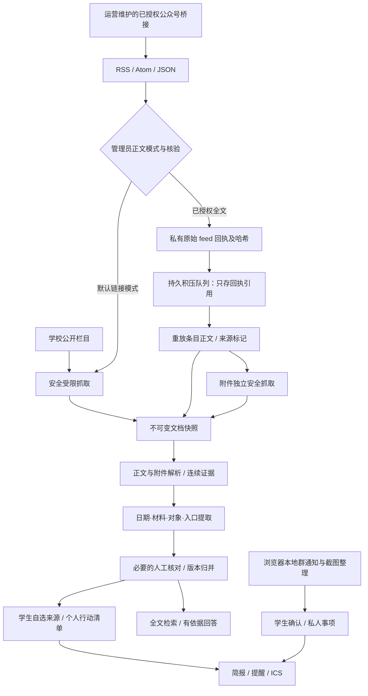

# 偷闲·天大版 1.3：授权供稿与正文增强

本版将网上和 GitHub 的方法落实到当前运行项目，重点减少接入公众号正文的失败、正文噪声和重复采集。它是可本地运行、带 Google Cloud 部署材料的交付版。尚无 Google Cloud 项目、公网服务或真实公众号授权；不能把工程验收当成实际校园采集已上线。

## 方法与取舍

| 官方项目/文档 | 采用的方法 | 落地结果 |
|---|---|---|
| [RSSHub](https://github.com/DIYgod/RSSHub) | 采集适配与阅读端通过标准订阅分离 | 采用 Atom content 或标准 JSON content_html；默认 RSS description 不当全文 |
| [WeRSS](https://github.com/rachelos/we-mp-rss) | 已授权的独立桥接服务提供公众号完整 XML/RSS | 开启授权正文模式后直接消费明确正文，不再先读 feed 又直抓微信；身份与授权由运营核验 |
| [Trafilatura](https://github.com/adbar/trafilatura)、[jusText](https://github.com/miso-belica/jusText)、[readability-lxml](https://github.com/buriy/python-readability) | 明确正文结构优先，去模板噪声，兼顾短材料与表格 | 用现有依赖实现小范围结构过滤；未知模板 partial，登录/验证码 failed，保留真实链接与连续证据 |
| [changedetection.io](https://github.com/dgtlmoon/changedetection.io) | 变化、健康和内容本身分开，失败有状态 | 延续不可变版本与差异提取；新增只读分阶段网络验收。没有引入其服务或宣称实现完整变化监控平台 |
| [Google Cloud 网络指南](https://docs.cloud.google.com/run/docs/configuring/networking-best-practices) | 固定服务网址、出口网络、真实可达性分别验收 | 保留同一 Cloud Run Service 的固定网址方案；同镜像独立采集验收器，默认不访问网络 |

详细核对版本、实际输出差异与许可证见 [WECHAT_FEED_GUIDE](WECHAT_FEED_GUIDE.md)。未复制第三方算法代码、未下载运行第三方桥接镜像、未增加新服务或依赖。RSSHub 当前核对版本为 AGPL-3.0，WeRSS 为 MIT；独立部署时各自遵守所选版本许可。

## 完整运行链路

Core、事务 Store、Outbox 与现有任务仍是共享基础。没有把多个 AI 的独立数据库或状态复制拼在一起。公共 API 保持 56 项；可选字段增加到共享 JSON Schema/OpenAPI，再统一合并客户端。1.3 可读旧数据，旧来源缺失正文模式时按 link 处理；旧快照不需要伪造 capture。

授权全文只在已核验且有非空授权依据的来源上消费。修改 URL、适配器、身份或正文模式撤销核验；授权中途变化会阻止提交。公开网 feed 使用 HTTPS，精确受控网关可显式例外。凭据不进 URL；原文和附件不继承 feed 凭据。

原始 feed 一次存私有 blob，由不可变回执记录最终 URL、类型、哈希与来源范围；积压 JSON 不存正文。重启后按回执重放，5xx 列表故障可继续已发现工作，401/403 不绕过。正文、标题或发布时间更正会形成新版本，相对日期重新锚定。学生和运营证据均显示“订阅供稿 · 原网页未直接核验”。条目原链接仅是出处，不代表已访问验证。公众号模式要求 HTTPS 且原链接主机严格为 mp.weixin.qq.com。

边界：每轮发现 100 条、批量 8 条、积压 500 条；单条全文 128 KiB，feed 8 MiB；超限失败，不把截断当全文。一个被上游错误填入全文字段的摘要仍可能漏内容，须由运营抽查。私有回执会积累，应和快照一起纳入存储预算、备份和保留期限；本轮不做自动删除，以免破坏证据及续采引用。

## 多 AI 分工和集成顺序

| 唯一责任人 | 文件边界 | 交接和验证 |
|---|---|---|
| A0 总集成 | sources.py、ingestion.py、feed_archive.py、共享契约、发行材料 | 冻结接口和默认兼容，串行合并；真实 Store/HTTP/浏览器、整包验收 |
| A1 Feed | feed_content.py、协议测试、WECHAT_FEED_GUIDE.md | parse_feed 纯函数；严格正文字段、Atom 链接、输入边界；独立复审授权与回执 |
| A2 正文 | content.py、正文开发回归、BODY_QUALITY.md | html_body_segments 纯函数；保留短材料、表格、标题、链接；访问验证失败；capture 继承 |
| A3 网络与界面 | probe_sources.py、部署验收说明、Docker COPY、App.jsx、专属浏览器脚本 | 只读真实网络诊断；模式切换撤销核验；学生证据来源提示 |

各人在独立 Git worktree 内修改专属文件；契约由 A0 统一修改。顺序为 feed 解析 → 正文 → 网络工具 → 界面 → 授权/持久化集成 → 独立复审和整体测试。后续扩展仍按 [CAMPUS_HANDOFF](CAMPUS_HANDOFF.md) 的业务拥有者边界执行。

## 验收事实与尚未证明的结果

本轮增加协议、授权正文、日期更正、重启续采、凭据、正文结构与网络诊断检查。最终后端通过 307 项及 91 子检查，普通测试中 8 项 PostgreSQL 专用检查跳过；另以实际临时 PostgreSQL 17.11 运行 18 项组合检查及 8 子检查通过，关闭并移除了临时集群。前端 22 单元检查和生产构建通过。独立交付目录的测试、浏览器和文件一致性记录以发行包的 `本版验收记录/final-verification.json` 为准。

12 个独立合成正文结构样例首次 11 通过、1 失败，失败是正文内联系方式被误清理；该样例随后成为开发回归并修复。修后全过不能称作独立准确率。原有 20 条官方短摘录开发语料的日期/材料仍 20/20 对应，不是完整通知准确率，也不是本轮新增的独立真实集。

真实网络探测的 15 个栏目均在 DNS 阶段返回 fake-IP 并被拒绝，未采到正文。报告证明阻挡位置，不证明学校宕机。Google run.app 入口在天津大学校园和移动网络的可达性还须现场验证。未创建云资源，未实际构建云镜像，未测试真实 GCS/SMTP/公众号授权，未做学生试用或节省时间测量。

## 运行、升级与回退

本地演示按 [README](README-CAMPUS.md)；授权源按 [公众号指南](WECHAT_FEED_GUIDE.md)；网络验收按 [NETWORK_ACCEPTANCE](deploy/cloudrun/NETWORK_ACCEPTANCE.md)；Google Cloud 固定网址按 [DEPLOY](deploy/cloudrun/DEPLOY.md)。未创建项目时保留默认预览模式，准备资料即可。

升级先暂停调度、停止旧 worker，备份数据库、配置、快照和 feed 回执，再切换统一 1.3 镜像。验证数据库、采集、审核、发布、提醒后再明确启用调度。1.2 不认识新增 capture/mode 字段，不能让新旧 worker 混跑；需回退时恢复配套的升级前数据库/对象存储备份和旧镜像。1.1、1.2 发行 ZIP 均保留，不覆盖历史交付。
